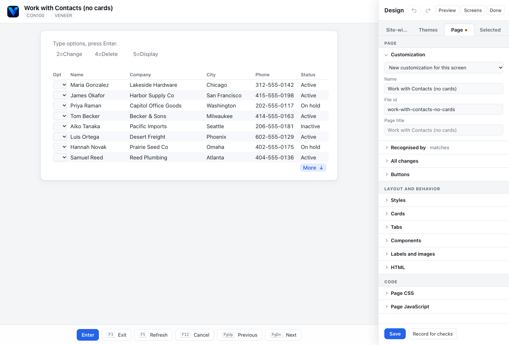

# The designer: customizing screens

The designer is the panel you use to change how a green screen looks in Veneer. You can
rename text, hide clutter, add buttons, turn fields into dropdowns and date pickers, group
things into cards and tabs, and give the whole site your company's look. You don't change
the host program, and the host still gets the same fields and keys as from a terminal.

Each screen's changes are saved as one file, a **customization** (or *screen definition*),
in the screens folder. Everyone's page picks it up as soon as you save.

**Contents:** [Getting in](#getting-in) · [The design panel](#the-design-panel) ·
[Your first customization](#your-first-customization) · [How to…](#how-to) ·
[Macros](#macros) · [Before a release](#before-a-release) · [Troubleshooting](#troubleshooting)

## Getting in

The designer is off until the server turns it on, in one of two ways:

| Setting | Who can use the designer |
| --- | --- |
| `VENEER_DESIGNER=local` | Browsers on the Veneer machine itself, or through an SSH tunnel to it, with no token. `npm run dev` and `npm run demo` turn this on. |
| `VENEER_DESIGNER_TOKEN=<12+ characters>` | Anyone who types the token |

The two can be combined. For an installed server, [Getting into the
designer](../deploy/README.md#getting-into-the-designer) shows both, including an SSH
tunnel to an IBM i.

Then:

1. Sign on and go to the screen you want to change.
2. Click **Design** in the page header. The panel opens beside the screen. If the screen
   was in the classic view, it switches to the modern view.
3. With a token: type it in **Designer token** at the bottom of the panel. The browser
   remembers it until you close the tab.

**No Design button?** The designer is off, or your browser isn't local and the server has no
token. Check the `designer` value in the server's `veneer listening` log line (`off`,
`local`, `token` or `local+token`). The button also waits until a screen is showing, and
hides while a help popover is open.

While the panel is open, the screen is yours to design: keys you press go to the panel,
not the host. Click **Done** to go back to using the application. If you have unsaved
changes, it asks before discarding them.

Try it on the demo first: `npm run build`, then `npm run demo`. Open
<http://127.0.0.1:8080>, sign on with any name, and pick a menu option. Options 5 and 6
are plain screens with no customization yet, and options 1 to 4, 7 and 11 to 18 are
already customized, so you can open the designer on them to see how they're built.

## The design panel



Along the top: **Undo** and **Redo** (also Ctrl+Z and Ctrl+Shift+Z), **Preview**,
**Screens** and **Done**. Below them are four tabs:

| Tab | What it changes | Saved with |
| --- | --- | --- |
| **Site-wide** | CSS and JavaScript for every page | **Save site** |
| **Themes** | The look of every page: colors, fonts, logo | **Save theme**, then **Use for everyone** |
| **Page** | This screen's customization: its name, title, how it's recognised, buttons, styles, cards, tabs, components, labels, HTML, CSS and JavaScript | **Save** |
| **Selected** | Whatever you last clicked on the screen | **Save** (it's part of the page's customization) |

A dot on a tab means it has unsaved changes.

**Selecting things.** Click any text, input field, list, menu option or empty spot on the
screen. The panel switches to **Selected** and shows what you clicked, with its position
(row and column) and its settings. Click the items in the page header bar (such as the
program name and system name) to change those too.

**Moving things.** Drag any selected item, or use the arrow keys. A list moves as a whole.
Moving only changes the layout. The host still gets its fields where it put them, and Tab
follows the new order.

**Preview** shows the screen as users will see it: hidden items gone, no outlines. The
screen is look-only while previewing. Click **Preview** again to carry on designing.

**Screens** opens the screen inventory: every screen Veneer has shown, how often people
open each one, and which customization recognises it. See [Find the screens worth
customizing](#find-the-screens-worth-customizing).

**The Page tab** is in three groups of sections. A section opens by itself when it has
something in it, and its heading shows a count (**Buttons · 2**) even when it's closed.

- **Page:** **Customization**, **Recognised by**, **Pasting rows** (screens with a list),
  **All changes**, **Buttons**
- **Layout and behavior:** **Styles**, **Cards**, **Tabs**, **Components**, **Labels and
  images**, **HTML**
- **Code:** **Page CSS**, **Page JavaScript**

At the bottom: **Save** (**Save changes** once it exists), **Revert**, **Delete** and
**Record for checks**.

## Your first customization

This walkthrough uses the demo's **Customer Addresses (no map)** screen (main menu option 5).
The steps are the same on any screen.

1. Open the screen and click **Design**. The screen has no customization, so the **Page**
   tab starts a new one: **New customization for this screen**, named after the screen's
   title. **Recognised by** says *matches*: the new customization is tied to this screen's
   ID.
2. Click the text **Customer**. In **Selected**, type `Customer number` in **Text** and
   set **Style** to **Bold**. The screen changes as you type.
3. Click the instruction line at the top ("Type a customer number, press Enter…") and tick
   **Hide**. In the designer it stays faint and crossed out so you can still select it,
   but users won't see it.
4. Go to the **Page** tab, open **Buttons**, and click **Add button**. Name it `Back to
   menu` and choose **F12** in the list beside it.
5. Open **All changes**. It lists the four changes you made, one line each. Click a line
   to select what it changes, or × to remove it.
6. Click **Preview** to check the page, then click it again to leave Preview.
7. Click **Save**. The panel says **Saved.** and writes
   `customer-addresses-no-map.json` in the screens folder. The page header shows a
   **Customized** badge.
8. Click **Done** and use the screen. The **Back to menu** button presses F12.

The saved file is plain JSON, so you can review it and commit it to git with the rest of
the screens folder:

```json
{
  "id": "customer-addresses-no-map",
  "name": "Customer Addresses (no map)",
  "host": "5250",
  "match": { "screenIds": ["1b132eb93e20d5"], "text": [] },
  "changes": [
    { "op": "text", "at": { "row": 4, "col": 2 }, "text": "Customer number" },
    { "op": "role", "at": { "row": 4, "col": 2 }, "role": "emphasis" },
    { "op": "hide", "at": { "row": 2, "col": 2 } },
    { "op": "button", "label": "Back to menu", "action": { "aid": "F12" } }
  ]
}
```

Every change the designer makes is one of these. The README's [Screen customizations and
the designer](../README.md#screen-customizations-and-the-designer) describes each kind for
people who'd rather edit the files.

## How to…

### Change or hide text

Click the text. In **Selected**:

- **Text** replaces what it says. Clear the box to go back to the host's own text, which
  is shown in grey as a reminder.
- **Style** restyles it: **Bold**, **Muted**, **Error**, **Warning**, **Accent**,
  **Highlight** or **Normal**. **As on the host** keeps the host's color.
- **Hide** removes it from the page. It works on fields and lists too. A hidden field
  still holds its value and is still sent to the host.

Menu options work the same way. Text in the page header bar (the program name, system
name, date) can be hidden, reworded and restyled by clicking it in the header.

### Change the page title

On the **Page** tab, under **Customization**, type the **Page title**. Leave it empty to
keep the host's title, which is shown in grey.

### Name the customization

Under **Customization**, **Name** is what the designer, the screen inventory and the admin
page call it. **File id** is its file name (`<id>.json`): lowercase letters, digits and
dashes. You can only change the id before the first save.

### Move things

Drag the item, or select it and use the arrow keys. The **Row** and **Column** boxes in
**Selected** show where it's drawn, and you can type a position there too. **Put back at
…** undoes a move.

### Group things in a card

Select an item and click **Add card around this**. Drag the card's corner on the screen to
resize it, then move items in or out of it. Give it a title on the **Page** tab, in
**Cards**.

### Split a long screen into tabs

Select something on the row where the second tab should start. On the **Page** tab, in
**Tabs**, click **Start a tab at row …**. Repeat for each further tab, then name the tabs
there. Click the tab titles on the screen to see each one. Fields on hidden tabs keep
their values and are still sent. A tab can't start inside a card.

### Add a button

On the **Page** tab, in **Buttons**, click **Add button**, type its label, and choose what
it does:

- **A key** (Enter, F1 to F24, PgUp, PgDn, Help, Print and so on): the button presses it.
- **Open URL**: the button opens a web page in a new tab. In the address, `{6:22}` is
  replaced by the field or text at row 6, column 22. Select a field and click **Insert
  selected** to add its position. The preview under the box shows the address made from
  the screen you're on.
- **Run macro**: the button runs a [macro](#macros) from this screen. Its values can come
  from the screen in the same way.

### Turn a field into a dropdown, date picker or other widget

Click the input field, then choose from **Show as**: **Dropdown**, **Radio buttons**,
**Checkbox**, **Switch**, **Date picker**, **Time picker**, **Text area**, **Masked
input** or **Lookup**. Its settings appear below. The [widgets
guide](widgets.md#field-widgets) covers each one.

### Let a paste fill more than one page

Users can paste rows from a spreadsheet into a list of entry fields (see [Pasting rows from
a spreadsheet](../README.md#pasting-rows-from-a-spreadsheet)). By default a paste fills the
page on screen and stops. On the **Page** tab, **Pasting rows** › **More rows than fit**
can instead press **Enter** or **Page Down** after each full page and go on pasting on the
next one. Choose it only for a screen where that key just adds the page's lines and shows
an empty page to type more, such as an order's line entry: Veneer presses it for every
full page. The last page is filled but not sent, so the user checks it and presses Enter.
Widgets on the list's fields, such as a date picker on a ship date column, also let a
paste take dates as `YYYY-MM-DD`.

### Show text as a badge, number, date or link

Click the text, then choose from **Show as**: **Status badge**, **Number**, **Date**, **Yes
or no**, **Link**, **Progress bar** or **Barcode or QR code**. For a list, click the list,
pick the **Column**, then **Show its cells as**. See [Output text](widgets.md#output-text).

### Highlight rows or values

On the **Page** tab, in **Styles**, click **Add style**. Choose what to check (a list column
by its heading, or the item you selected), the test (**is**, **contains**, **matches
pattern**, **is less than**, **is more than**), the value, the style, and for a list,
**whole row** or **this cell**. Under each rule, the panel says how many rows it matches on
this screen, such as *Matches 2 of 8 rows on this screen*.

### Add a label, picture or HTML

Click an empty spot on the screen. **Selected** offers **Add label here**, **Add image
here** and **Add HTML here**. You can also use **Add label** and **Add image** in the
**Labels and images** section, or **Add HTML** in **HTML**, on the **Page** tab. Labels
can have a help note shown from an ⓘ. See [Labels and images](widgets.md#labels-and-images)
and [Custom HTML, CSS and JavaScript](../README.md#custom-html-css-and-javascript).

### Place a chart, board, calendar or other component

On the **Page** tab, in **Components**, pick one and click **Add component**. Drag it
into place, and type its **Options (JSON)** in **Selected**. The [components
guide](components.md#placing-a-component) describes each one and its options.

### Add CSS or JavaScript

- **This screen only:** **Page CSS** and **Page JavaScript** on the **Page** tab. A script
  can run when the screen opens (**Screen opens**) or on every redraw (**Every redraw**).
- **Every page:** the **Site-wide** tab, saved with **Save site**.

**Test script** runs the script once on the screen. Scripts don't run by themselves while
you design. See [Custom HTML, CSS and JavaScript](../README.md#custom-html-css-and-javascript).

### Give the site your company's look

On the **Themes** tab, pick a theme to see the screen in it. To make your own, type a name
under **New theme** and click **Make a copy**, then edit its **Style sheet** (**CSS
variables** inserts the usual settings) and add a logo under **Artwork**. Click **Save
theme**, then **Use for everyone**. Built-in themes can be copied but not changed. See
[Themes](../README.md#themes).

### Use one customization for several screens

Some screens come in variants with different screen IDs, such as a list with no records.
Open the variant and click **Design**. Under **Customization**, pick the existing
customization instead of **New customization for this screen**. Then in **Recognised
by**, click **Add this screen**, and **Save changes**.

If two different screens share an ID (the same layout and title), tell them apart with
text: select some text that only one of them has and click **Also require "…"**.

### Undo, revert or delete

- **Undo** and **Redo** step through your changes on the **Page** and **Selected** tabs.
  In a text box, Ctrl+Z undoes the typing there instead.
- **Revert** goes back to the saved customization.
- **Delete** removes the customization file, after asking. The screen goes back to the
  automatic layout.

### Find the screens worth customizing

Click **Screens** at the top of the panel. The inventory lists every screen Veneer has
shown, across all users: title, screen ID, number of input fields, visits, when it was
last seen, its customization and the macros that use it. Sort by **Most visited** and tick
**Not customized yet** to see where a customization helps most people. Only the screen's
shape is recorded, never what was on it.

## Macros

A macro replays the keys to reach a screen, so a button, a link or the **Go to** menu can
take people straight there. With the designer on, **Macros** in the page header opens the
Macros panel:

1. Go to the screen the macro should start from, such as the main menu.
2. Click **Record**, then use the application as usual. Each key you press becomes a step.
   Passwords are never recorded.
3. Click **Stop**, and give the macro a **Name people see**.
4. To have a value given each time, such as an order number, click **Make value** next to
   what you typed and name it. Set what's **Allowed** and whether it's **Required**.
5. **Test** runs it from the screen you're on. Tick **List under Go to in the page header**
   to add it to the menu, and copy the **Link that starts it in a new session** for emails
   and intranet pages.
6. Click **Save**.

Once saved, a button can run it: see [Add a button](#add-a-button). The README's [Macros
and deep links](../README.md#macros-and-deep-links) has the details.

## Before a release

If a display file is recompiled with a different field layout, its screen ID changes and
the customization stops applying. Nothing reports this: users just get the automatic layout
again. To catch it, record each customized screen: open it in the designer and click
**Record for checks**. This writes `snapshots/<id>.json` in the screens folder. Commit it
with the customization, and `veneer check` will test the customization against it. A
recording keeps what the screen showed, such as customer names, so record on a test
system. See [Checking definitions in CI](../README.md#checking-definitions-in-ci).

## Troubleshooting

**Save is greyed out.** Nothing has changed since the last save. Otherwise check these:
the **File id** is empty or invalid; **Recognised by** has no screen ID or text rule;
or, with a token, **Designer token** is empty.

**"Enter a valid designer token."** The token typed doesn't match `VENEER_DESIGNER_TOKEN`.

**Recognised by says "does not match".** You picked a customization made for another
screen. Click **Add this screen**, or pick **New customization for this screen**.

**A customization stopped applying.** The screen's ID probably changed after the display
file was recompiled. Open the screen, pick the customization under **Customization**,
click **Add this screen** and remove the old ID with ×. **Screens** shows each screen's
current ID. [Record the screen](#before-a-release) so `veneer check` catches it next time.

**A change shows on one screen but another customization wins.** If several customizations
match a screen, one recognised by screen ID wins, then the one with the most text rules.
Open **Screens** to see which one recognises it.

**My script didn't run.** Scripts are paused while the designer is open. Click **Test
script**, or click **Done** and use the screen. A new **Page load** script on the
**Site-wide** tab runs after you reload the page.

**The Run macro choice is greyed out.** No macros are installed yet. Record one first
([Macros](#macros)).
